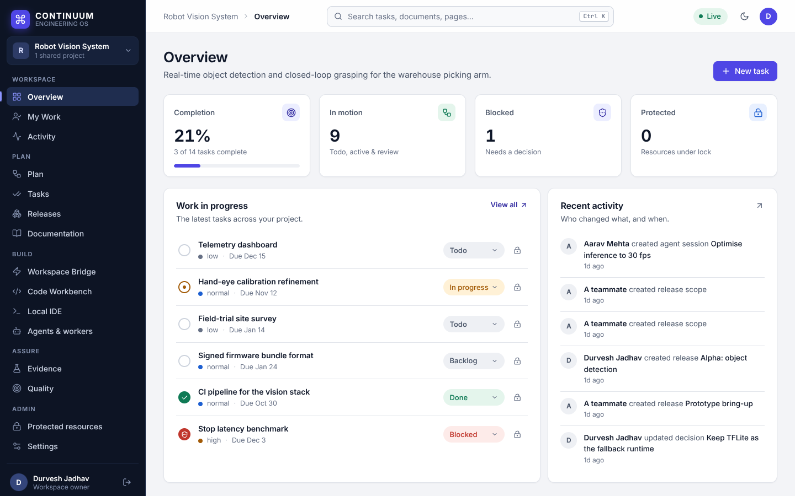
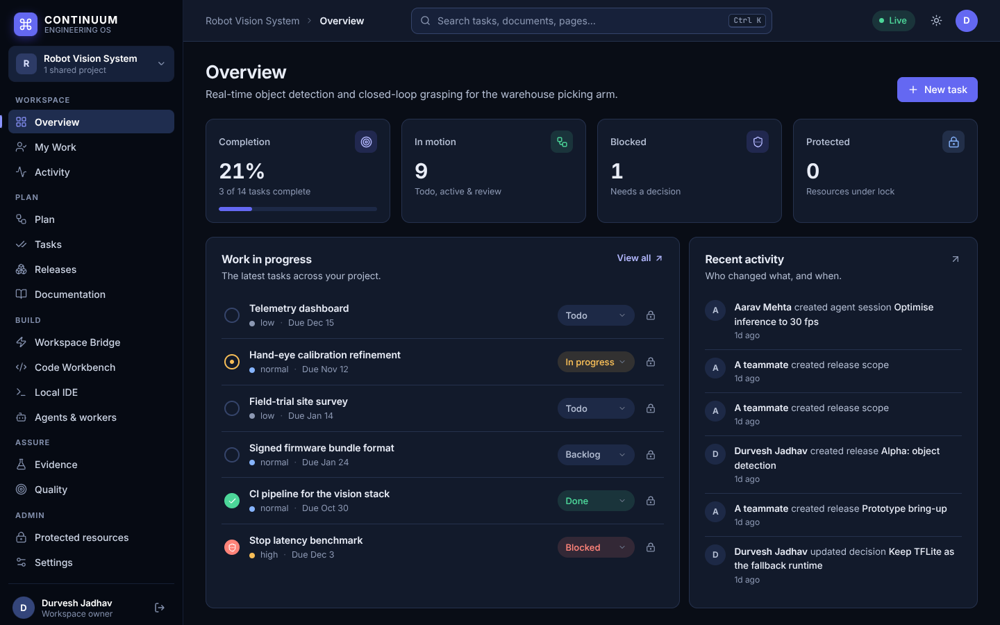

# CONTINUUM dashboard design system ("Solid")

The dashboard was redesigned around one idea: **a calm, dense, readable workspace with one confident accent.**
Everything people read is at least 13 px (body 14 px, Inter), contrast meets WCAG AA, and colour is used only for meaning.

## Principles
1. **One anchor, one accent.** A dark navy sidebar anchors navigation; indigo is the only brand colour. Green, amber, red and blue appear only as status.
2. **One search, one place for everything.** `Ctrl/⌘ K` jumps to any page and searches tasks, requirements, documents, decisions, defects and releases. The old second palette was removed.
3. **Actions live where they apply.** "New task" appears on Overview only; boards own their refresh icons; no page repeats another page's buttons.
4. **One title, one sentence.** Cards have a heading and a single explanatory line. Long pages (Evidence, Quality) use tabs instead of stacking panels.
5. **Say it in words people use.** The activity feed reads "*Aarav Mehta created task Telemetry dashboard*", not `tasks insert`.
6. **Honest UI.** The decorative notification bell and fake "live" cards were removed; every control does something.

## Information architecture
`Workspace` (Overview, My Work, Activity) · `Plan` (Plan, Tasks, Releases, Documentation) · `Build` (Workspace Bridge, Code Workbench, Local IDE, Agents & workers) · `Assure` (Evidence, Quality) · `Admin` (Protected resources, Settings).

## Tokens (`apps/web/src/styles/01-base.css`)
- Surfaces: `--canvas`, `--surface`, `--surface-2/3`; borders `--border`, `--border-strong`; text `--text`, `--text-2`, `--text-3`.
- Accent `--accent` (+ `-hover`, `-soft`, `-text`); semantic `--success`, `--warning`, `--danger`, `--info` each with a `-soft` tint.
- Sidebar `--side-*`. Radius 6/8/12, shadows `--shadow-sm`, `--shadow`, `--shadow-pop`, focus ring `--focus`.
- Light and dark themes switch on `:root[data-theme]`; every colour in the app comes from these tokens.

## Files
| File | Contents |
|---|---|
| `01-base.css` | tokens, typography, form controls, buttons, badges |
| `02-shell.css` | sidebar, top bar, page header, responsive shell (mobile drawer at ≤ 860 px) |
| `03-components.css` | cards, metrics, task/activity lists, evidence/plan/knowledge blocks, roadmap, search palette, modals |
| `04-legacy.css` | Code Workbench, Local IDE, sign-in and setup screens, re-coloured from the previous stylesheet into the new palette |
| `05-agents.css` | agent console (it previously had no styles at all) |

Fonts (Inter, JetBrains Mono) are bundled with the app, so the dashboard and the desktop shell look identical offline.

## Verified visually
Every page was rendered in a headless browser against realistic seeded data in light and dark themes, plus a 390 px phone layout.
To reproduce: apply the migrations to a scratch database, then `WEB_DIR=apps/web DATABASE_URL=postgres://… node supabase/demo/seed.mjs`
(a believable robotics project: requirements, tasks with dependencies, tests, CI runs, defects, documents, decisions and releases).
