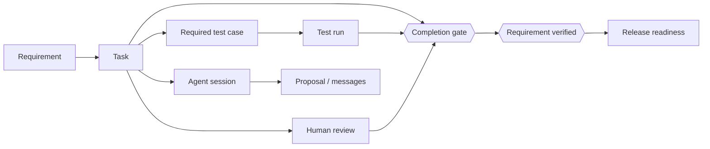

# CONTINUUM Engineering OS — design and build plan

CONTINUUM is not an IDE with a chatbot. It is a governed engineering environment in which people, AI agents,
code, tasks, documents, tests and decisions share **one project identity**, and in which "done" means *proven*.

This document turns the product vision into build-ready design. Status markers: ✅ built and tested · 🟡 partial · ⬜ designed, not built.

## 1. The five layers

| # | Layer | Responsibility | Status |
|---|---|---|---|
| 1 | Desktop engineering environment (Theia: editor, terminal, Git, debug) | Where engineers touch real files | 🟡 candidate exists; installer unverified |
| 2 | CONTINUUM product experience (dashboard: **Plan, Evidence, Quality, Releases, Knowledge**; cloud panel; agent console) | Workflows that make it more than an IDE | 🟡 project-management modules ✅; Theia panel early |
| 3 | Agent orchestration (Planner/Coder/Reviewer/QA, routing, checkpoints) | Coordinate AI work and handoffs | 🟡 single explicit step ✅; scheduler/handoff ⬜ |
| 4 | Shared project intelligence (Supabase: Auth, Postgres, RLS, Realtime) | One governed source of truth | ✅ incl. evidence model (M1) |
| 5 | Execution and evidence (workers, builds, tests, CI, artifacts) | Verify work actually happened | 🟡 manual evidence ✅; trusted worker evidence ⬜ |

Principle: the desktop, the dashboard and agents act on the **same governed records**. No layer keeps a private copy of project state.

## 2. The traceability graph

Everything a project knows is reachable from the requirement that motivated it.

✅ Implemented in migration `202610220001_evidence_gating.sql`: `tasks.requirement_id`, required `test_cases`, immutable `test_runs`
and `task_reviews`, and the two gates below. ⬜ Next links: `agent_sessions → task` is present; `release → requirements` is future work.

## 3. The completion gate (built, tested on real Postgres)

A task may move to `done` only if **all** hold (enforced by a database trigger, so the dashboard, the IDE, an API call and an agent cannot bypass it):

1. Every *required* test case linked to the task (or to its requirement) has a **latest** run of `passed`; if no cases exist, the latest run recorded for the task passed.
2. The latest review is a **human** `approved`, recorded **after** the most recent test run (a newer run makes an old approval stale).
3. In projects with 2+ members, the **assignee cannot approve their own work**.
4. A passing run followed by a failing run blocks completion again (regressions count).

Escape hatch: only a project **owner** can complete with a written waiver (≥5 chars). Waivers are audited and shown separately in project health, so they cannot masquerade as verified work.
Reopening a task clears its completion stamp and waiver.

A requirement becomes `verified` only when it has ≥1 linked task, all linked tasks are done, and all its required tests pass.

Evidence integrity rules, each covered by a SQL test:
- test runs and reviews are **append-only** for members; they are recorded **as yourself** (`executed_by = auth.uid()`), and members cannot claim to be `system`/`agent`;
- agents **cannot approve** (`reviewer_type` must be `human`);
- evidence cannot cross projects (a member of A cannot attach passing runs to B's task);
- only owners can switch evidence off for a task.

## 4. Actors and capabilities

| Capability | Owner | Collaborator | AI agent | System automation |
|---|---|---|---|---|
| Create tasks/requirements | ✅ | ✅ | proposes | — |
| Record test result | ✅ | ✅ (as self) | ⬜ via worker lease | ⬜ signed worker evidence |
| Approve work | ✅ | ✅ (not own work) | ❌ never | ❌ |
| Complete a task | with evidence or waiver | with evidence | ❌ | ❌ |
| Waive evidence / disable it | ✅ | ❌ | ❌ | ❌ |
| Verify requirement | when gate passes | when gate passes | ❌ | ❌ |
| Apply agent proposal to local files | user-approved only | user-approved only | ❌ | ❌ |

## 5. Agent work unit

```mermaid
stateDiagram-v2
  [*] --> queued: human creates session for a task
  queued --> running: atomic claim (compare-and-swap)
  running --> needs_review: proposal validated (paths, size, blocked dirs)
  running --> failed: provider/validation error
  running --> queued: stale after 5 min (reclaimed)
  needs_review --> queued: human requests revision / next role
  needs_review --> applied: human approves; local backup written
  applied --> evidence: tests run, results recorded
  evidence --> [*]: completion gate
```

✅ queued→running→needs_review/failed, stale reclaim, validated proposals. ⬜ `applied`, `evidence` transitions need the workspace bridge (M2) and worker (M3).

## 6. Milestones

### M1 — Evidence & traceability ✅
DB model, gates, `project_health`, `task_completion_status`, Evidence page (command center, traceability, readiness, record test/review/complete/waive). 29 SQL assertions on real Postgres + a CI job.

### M1.5 — Project-management modules ✅ (built and tested)
The dashboard now covers the "engineering workspace" table from the vision, all backed by database-enforced rules:

| Module | Page | What it does | Enforced in the database |
|---|---|---|---|
| Work management | **Plan** | Milestones with computed progress and at-risk detection, workstreams, assignees, due dates, subtasks, task dependencies | no cross-project references; assignees must be members; no hierarchy or dependency loops; a task cannot complete while dependencies/subtasks are open; a milestone cannot complete with open tasks |
| Governance & evidence | **Evidence** | Command center, requirement traceability, completion readiness, record tests/reviews | M1 gates |
| Quality | **Quality** | Test cases, results, requirement coverage gaps, defect/risk register | open high-severity defects block task completion and releases; only owners accept a risk |
| Release management | **Releases** | Scope a release to requirements, readiness check, generated notes, owner-only release with commit SHA | not ready unless all scoped requirements are verified and no serious defect is open; released scope is frozen |
| Documentation & knowledge | **Documentation** | Markdown documents (safe renderer), full version history, restore, optimistic-concurrency saves, ADR-style decisions | stale saves rejected (HTTP 409); only owners accept decisions; accepted decisions are immutable (supersede instead) |
| Project graph | all pages | Typed links between tasks, requirements, documents, decisions, defects, tests, milestones and releases, visible from both ends | links must stay inside the project; deleting an item removes its links |

Verification: 91 SQL assertions on real PostgreSQL (3 suites), a 78-check end-to-end run of the dashboard's real queries through PostgREST with signed JWTs and RLS (`supabase/tests/api-smoke/run.sh`), 28 worker tests (incl. the bridge's preview/apply/staleness rules), markdown-renderer injection tests, and strict TypeScript builds. All run in CI.

### M2 — Workspace bridge ✅ (worker + dashboard path; Theia panel next)
*Goal:* an agent step uses the **real local checkout**, and nothing is sent or written without you seeing it first. Built as the **Workspace Bridge** page plus new worker endpoints, so it is testable today and the Theia panel can reuse the same endpoints.

| Step | What happens | Safety |
|---|---|---|
| 1 Task & session | pick an open task, create an agent session with a goal and up to 12 context paths | RLS; sessions belong to the task |
| 2 Context preview | `POST /api/worker/agents/context` lists exactly which files (and bytes) will be sent | secret-like, ignored, missing, empty and >18 KB files are never sent; budget shown |
| 3 Agent step | worker runs one step with that context | proposal validated server-side |
| 4 Review & apply | `POST /agents/preview` returns a per-file unified diff (new / modified / unchanged / blocked) and a base hash; you tick files; `apply-proposal` writes only those | refuses if a file changed after review (409); CI/hook/editor-task paths and locked paths blocked; rollback on failure; audit message |
| 5 Verify | run allowed checks locally (`npm test`, `npm run build`, `pytest`…) | allow-listed commands only; worker secrets scrubbed from child env |
| 6 Evidence | "Record as evidence" stores result, commit SHA (`/git/head`), duration, log excerpt, and notes uncommitted changes | recorded as yourself, immutable, feeds the completion gate |

Still ⬜: the same flow as a Theia side panel, and worker-signed evidence (M3).

### M2.5 — Workspace hub ✅
| Module | What it does |
|---|---|
| **My Work** | one call (`my_work`) for tasks assigned to me (overdue / waiting-on-prerequisite flagged), work waiting for *my* review (evidence-based: passing run, no review from me since), my open defects, and — for owners — decisions to decide |
| **Search (Ctrl/⌘ K)** | `search_project` over tasks, requirements (incl. keys), documents (with a snippet around the match), decisions, defects, milestones, releases and tests; LIKE characters escaped, minimum 2 characters, RLS-scoped |
| **Roadmap** | timeline of dated milestones on the Plan page with a today marker and at-risk colouring |

### M2b — Theia side panel (next, small)
Reuse the endpoints above from the Theia cloud panel: "Select context" from open editors, the same diff review and per-file apply, then "Run tests" → evidence. Acceptance: one task goes requirement → proposal → apply → local test → evidence → human approval → done inside Theia, with no manual DB edits.

### M3 — Trusted execution (next)
*Problem:* manual evidence is honest-user evidence. A leased worker makes it verifiable.
- `worker_leases(task_id, worker_id, expires_at)`; a worker records runs through a `SECURITY DEFINER` RPC that stamps `actor_type='system'`, the worker identity, command, exit code, commit SHA, log hash.
- Gate option `evidence_source = 'worker'` per project: manual runs no longer count.
- Isolated task workspace (git worktree), command allow-list per task, timeouts, output caps, secrets scrubbed (already done for the legacy worker).

### M4 — Orchestration
Scheduler with bounded concurrency and per-project/user quotas; role handoffs (Planner→Coder→Reviewer→QA) driven by task state; resumable checkpoints; QA agent may only *cite recorded evidence* (its prompt receives `task_completion_status`, and it cannot mark anything passed).

### M5 — Knowledge & release
Documents/decisions linked to tasks and requirements; release readiness = all linked requirements verified + artifacts recorded; analytics (cycle time, first-pass test rate, waiver rate).

### M6 — Hardening for scale
Server-side agent messages (closes the "forgeable assistant message" gap), signed proposals, rate limits, signed installers, e2e tests across dashboard ↔ API ↔ Theia.

## 7. Known gaps (honest list)
1. A project member can still insert a forged `assistant` agent message that "Apply" will trust → fixed in M6, mitigated now by showing every path and blocking automation directories.
2. Manual test evidence relies on the recorder's honesty until M3.
3. Theia installer not yet validated; PySide6 app remains the fallback.
4. No per-user rate limiting on agent runs yet.
