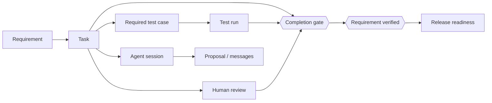

# CONTINUUM Engineering OS — design and build plan

CONTINUUM is not an IDE with a chatbot. It is a governed engineering environment in which people, AI agents,
code, tasks, documents, tests and decisions share **one project identity**, and in which "done" means *proven*.

This document turns the product vision into build-ready design. Status markers: ✅ built and tested · 🟡 partial · ⬜ designed, not built.

## 1. The five layers

| # | Layer | Responsibility | Status |
|---|---|---|---|
| 1 | Desktop engineering environment (Theia: editor, terminal, Git, debug) | Where engineers touch real files | 🟡 candidate exists; installer unverified |
| 2 | CONTINUUM product experience (dashboard, cloud panel, agent console, **Evidence**) | Workflows that make it more than an IDE | 🟡 dashboard + Evidence ✅; Theia panel early |
| 3 | Agent orchestration (Planner/Coder/Reviewer/QA, routing, checkpoints) | Coordinate AI work and handoffs | 🟡 single explicit step ✅; scheduler/handoff ⬜ |
| 4 | Shared project intelligence (Supabase: Auth, Postgres, RLS, Realtime) | One governed source of truth | ✅ incl. evidence model (M1) |
| 5 | Execution and evidence (workers, builds, tests, CI, artifacts) | Verify work actually happened | 🟡 manual evidence ✅; trusted worker evidence ⬜ |

Principle: the desktop, the dashboard and agents act on the **same governed records**. No layer keeps a private copy of project state.

## 2. The traceability graph

Everything a project knows is reachable from the requirement that motivated it.

✅ Implemented in migration `202610220001_evidence_gating.sql`: `tasks.requirement_id`, required `test_cases`, immutable `test_runs`
and `task_reviews`, and the two gates below. ⬜ Next links: `agent_sessions → task` is present; `release → requirements` is future work.

## 3. The completion gate (built, tested on real Postgres)

A task may move to `done` only if **all** hold (enforced by a database trigger, so the dashboard, the IDE, an API call and an agent cannot bypass it):

1. Every *required* test case linked to the task (or to its requirement) has a **latest** run of `passed`; if no cases exist, the latest run recorded for the task passed.
2. The latest review is a **human** `approved`, recorded **after** the most recent test run (a newer run makes an old approval stale).
3. In projects with 2+ members, the **assignee cannot approve their own work**.
4. A passing run followed by a failing run blocks completion again (regressions count).

Escape hatch: only a project **owner** can complete with a written waiver (≥5 chars). Waivers are audited and shown separately in project health, so they cannot masquerade as verified work.
Reopening a task clears its completion stamp and waiver.

A requirement becomes `verified` only when it has ≥1 linked task, all linked tasks are done, and all its required tests pass.

Evidence integrity rules, each covered by a SQL test:
- test runs and reviews are **append-only** for members; they are recorded **as yourself** (`executed_by = auth.uid()`), and members cannot claim to be `system`/`agent`;
- agents **cannot approve** (`reviewer_type` must be `human`);
- evidence cannot cross projects (a member of A cannot attach passing runs to B's task);
- only owners can switch evidence off for a task.

## 4. Actors and capabilities

| Capability | Owner | Collaborator | AI agent | System automation |
|---|---|---|---|---|
| Create tasks/requirements | ✅ | ✅ | proposes | — |
| Record test result | ✅ | ✅ (as self) | ⬜ via worker lease | ⬜ signed worker evidence |
| Approve work | ✅ | ✅ (not own work) | ❌ never | ❌ |
| Complete a task | with evidence or waiver | with evidence | ❌ | ❌ |
| Waive evidence / disable it | ✅ | ❌ | ❌ | ❌ |
| Verify requirement | when gate passes | when gate passes | ❌ | ❌ |
| Apply agent proposal to local files | user-approved only | user-approved only | ❌ | ❌ |

## 5. Agent work unit

```mermaid
stateDiagram-v2
  [*] --> queued: human creates session for a task
  queued --> running: atomic claim (compare-and-swap)
  running --> needs_review: proposal validated (paths, size, blocked dirs)
  running --> failed: provider/validation error
  running --> queued: stale after 5 min (reclaimed)
  needs_review --> queued: human requests revision / next role
  needs_review --> applied: human approves; local backup written
  applied --> evidence: tests run, results recorded
  evidence --> [*]: completion gate
```

✅ queued→running→needs_review/failed, stale reclaim, validated proposals. ⬜ `applied`, `evidence` transitions need the workspace bridge (M2) and worker (M3).

## 6. Milestones

### M1 — Evidence & traceability ✅ (this change)
DB model, gates, `project_health`, `task_completion_status`, Evidence page (command center, traceability, readiness, record test/review/complete/waive). 29 SQL assertions on real Postgres + a CI job.

### M2 — Workspace bridge (next)
*Goal:* an agent step uses the **open local workspace**, and approved changes land in it — nothing uploads silently.
- Theia extension: "Select context" (open editors + chosen files + diff) → bounded snippets (≤12 files, ≤150 KB, secret/automation paths excluded, shown to the user *before* sending).
- Proposal review view: per-file diff, review notes, per-file accept; backups under `.continuum/backups/`; refuse protected paths (already enforced server- and client-side).
- After apply, the panel offers "Run tests" and records the result as evidence on the task.
- Acceptance: a recorded demo run where one task goes requirement → proposal → apply → local test → evidence → human approval → done, with no manual DB edits.

### M3 — Trusted execution
*Problem:* manual evidence is honest-user evidence. A leased worker makes it verifiable.
- `worker_leases(task_id, worker_id, expires_at)`; a worker records runs through a `SECURITY DEFINER` RPC that stamps `actor_type='system'`, the worker identity, command, exit code, commit SHA, log hash.
- Gate option `evidence_source = 'worker'` per project: manual runs no longer count.
- Isolated task workspace (git worktree), command allow-list per task, timeouts, output caps, secrets scrubbed (already done for the legacy worker).

### M4 — Orchestration
Scheduler with bounded concurrency and per-project/user quotas; role handoffs (Planner→Coder→Reviewer→QA) driven by task state; resumable checkpoints; QA agent may only *cite recorded evidence* (its prompt receives `task_completion_status`, and it cannot mark anything passed).

### M5 — Knowledge & release
Documents/decisions linked to tasks and requirements; release readiness = all linked requirements verified + artifacts recorded; analytics (cycle time, first-pass test rate, waiver rate).

### M6 — Hardening for scale
Server-side agent messages (closes the "forgeable assistant message" gap), signed proposals, rate limits, signed installers, e2e tests across dashboard ↔ API ↔ Theia.

## 7. Known gaps (honest list)
1. A project member can still insert a forged `assistant` agent message that "Apply" will trust → fixed in M6, mitigated now by showing every path and blocking automation directories.
2. Manual test evidence relies on the recorder's honesty until M3.
3. Theia installer not yet validated; PySide6 app remains the fallback.
4. No per-user rate limiting on agent runs yet.
